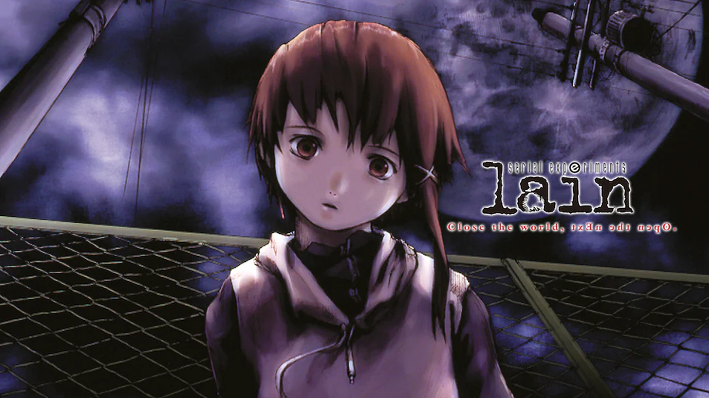

<div align="center">



[](https://git.io/typing-svg)

> *"No matter where you go, everyone's connected."*
> — Serial Experiments Lain


</div>

---

```text
NAVI v.7 — connection established
$ whoami
> neura
$ status
> online in the Wired
```

### `Layer 01 — whoami`

Software engineer. I build things, break things, and read about why both matter.

- 🔌 **Vibecoding** — my home turf. I prototype ideas fast and let the code talk.
- 📖 **Reading** — books with a message, mostly Asian literature.
- 🎮 **Gaming & VR** — whatever genre catches me next.
- 🖨️ **3D printing** — always something on the build plate.
- 🎧 **Music** — electronic with meaning, and classical film scores.

### `Layer 02 — signal`

| | |
|---|---|
| **Anime** | *Serial Experiments Lain* · *Attack on Titan* · *Chi* |
| **Cyberpunk** | androids, replicants, ghosts in the shell |
| **Books** | Asian literature, books with a message |
| **Music** | Future Riddim · Uptempo · Breakcore · classical film music |
| **Worlds** | VRChat · the Wired · wherever the signal leads |

> *"God is in the Wired."*

<div align="center">


</div>

---

### `Layer 03 — stack`


---

### `Layer 04 — stats` · the Wired keeps score

<div align="center">


</div>

---

### `Layer 05 — most popular` · what hit hardest

<!-- POPULAR-REPOS:START -->
- [kindle-screensaver-converter-gui] (https://github.com/neura-neura/kindle-screensaver-converter-gui) — 39 stars · Python · This project provides a graphical user interface (GUI) for converting images into Kindle-compatible screensavers, simplifying the process by leveraging the core functionality of the original Kindle Screensaver Converter script made by me.
- [Check-OTA-status] (https://github.com/neura-neura/Check-OTA-status) — 36 stars · Shell · This scriptlet checks the status of OTA (Over-The-Air) update binaries on Kindle devices and informs the user whether updates are enabled or blocked.
- [kindle-screensaver-converter] (https://github.com/neura-neura/kindle-screensaver-converter) — 17 stars · Python · This Python script converts images into screensavers compatible with Kindle devices (in order to replace the default ones if you know how or use them as screensavers in KOReader).
- [tagtag] (https://github.com/neura-neura/tagtag) — 8 stars · Kotlin · Android music tag editor for local audio files
<!-- POPULAR-REPOS:END -->

### `Layer 06 — latest` · most recent projects

<!-- RECENT-REPOS:START -->
- [christmas-print-studio] (https://github.com/neura-neura/christmas-print-studio) · Python · Touch-friendly Christmas ornament and name production planner for Bambu Lab A1, with a native macOS app.
- [utena-mic] (https://github.com/neura-neura/utena-mic) · Java · Use an Android phone as a Windows microphone over your local network.
- [neura-cinema] (https://github.com/neura-neura/neura-cinema) · HTML · Interfaz web para preparar sesiones temporales de video y subtítulos en un servidor propio
- [roku-app-launcher] (https://github.com/neura-neura/roku-app-launcher) · Python · A Roku development channel that loads SceneGraph apps from a LAN catalog.
<!-- RECENT-REPOS:END -->

---

<div align="center">

```text
// close the world, open the next
// you are here, and so am I
// let's all love Lain
```

</div>
